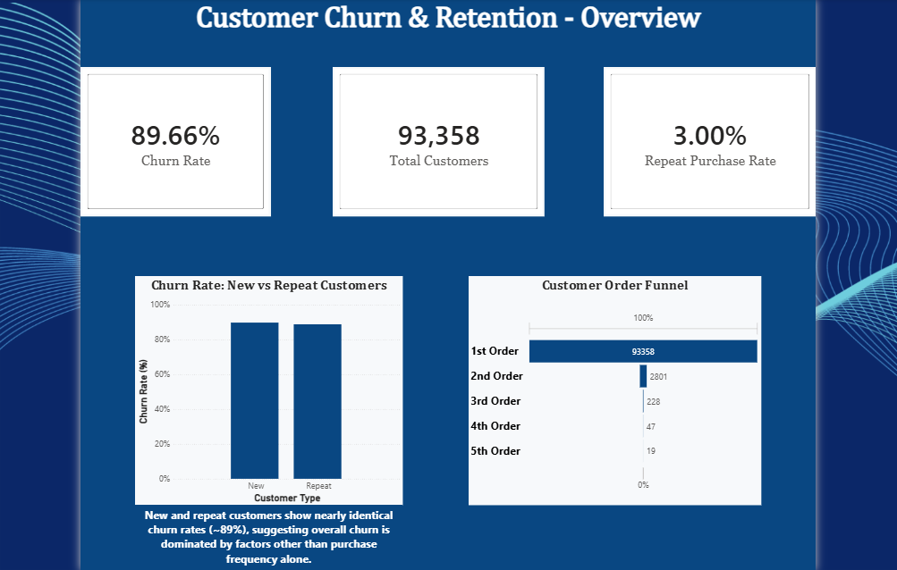
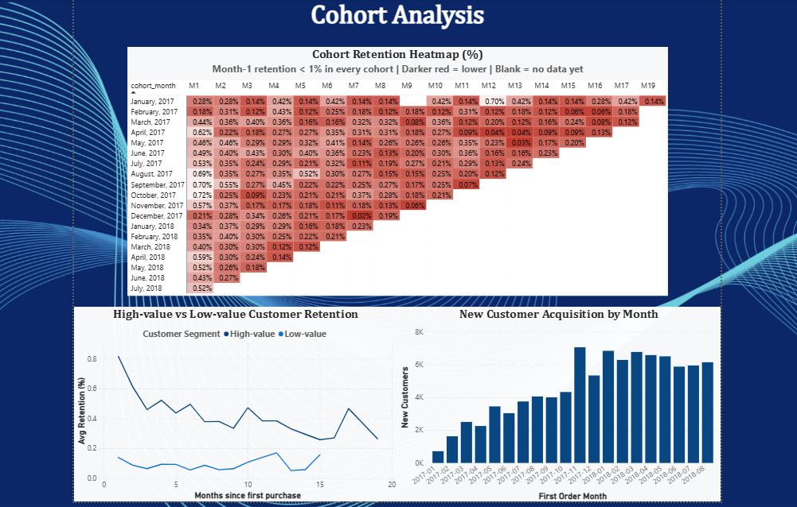
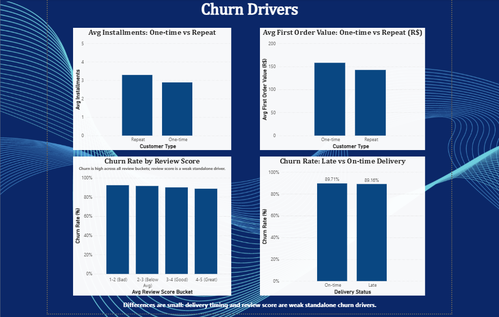
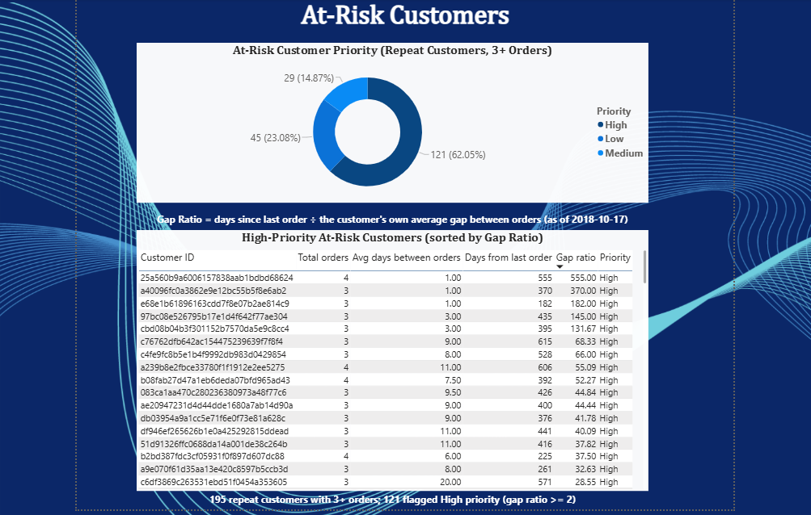

# Customer Retention & Churn Analysis
### Why are customers not coming back? — An analysis using the Olist Brazilian E-Commerce dataset

## Problem Statement
E-commerce businesses often focus heavily on acquiring new customers, but a leaking retention funnel can silently erode growth. This project investigates **why customers don't return** after their first purchase, using order, delivery, review, and payment data from ~96,000 customers over a 2-year period (Jan 2017 – Aug 2018).

## Dashboard Preview

Full dashboard (all 4 pages): [churn_dashboard.pdf](Dashboard/Churn_Dashboard.pdf)

## Data
Dataset: [Olist Brazilian E-Commerce (Kaggle)](https://www.kaggle.com/datasets/olistbr/brazilian-ecommerce). Download the CSVs and place them in the project folder to re-run the notebook.

## Tools Used
- **DuckDB** (SQL) — querying CSV data directly for joins, window functions, and aggregations
- **Python** (pandas, matplotlib, seaborn) — data cleaning, analysis, and visualization
- **Jupyter Notebook** — end-to-end analysis environment
- **Power BI** — 4-page interactive dashboard (overview, cohort analysis, churn drivers, at-risk customers)

*Note: DuckDB was used for fast, CSV-native local analytics. Core SQL (joins, CTEs, window functions) is standard and portable to MySQL/PostgreSQL with minor syntax differences (e.g., date functions).*

---

## 1. Churn Definition
Rather than assuming a fixed 30-day churn window, the threshold was derived from actual repeat-purchase behavior:
- Inter-purchase gap analysis of repeat customers showed a **median gap of 69 days** and a **75th percentile of 169 days**.
- A flat 30-day window would misclassify a large share of genuine repeat customers as "churned."
- **Final definition: a customer is considered churned if no order has been placed in 90 days** from the snapshot date (2018-10-17, the dataset's last recorded order).
- **Overall churn rate under this definition: 89.66%.**

## 2. Segmentation
- **New vs. Repeat:** 97% of customers placed only one order; just 3% became repeat buyers. Churn rates for the two groups are almost identical (89.7% vs 88.7%), so overall churn is dominated by factors other than purchase frequency alone.
- **High-value vs. Low-value:** Customers split by median total spend (R$107.78). High-value customers (by total spend) showed a month-1 retention rate roughly 6x higher than low-value customers (0.82% vs 0.14%), but this comparison is partly circular (see Limitations): repeat buyers naturally accumulate higher total spend. First-order value alone did not predict a return (see Section 3), so this should be read as "repeat buyers spend more", not "big spenders are more loyal".

## 3. Behaviour Before Churn
Several factors were tested to explain why customers don't return:

| Factor | Finding |
|---|---|
| Late delivery | Minimal impact — churn rate nearly identical for late vs on-time deliveries (89.2% vs 89.7%) |
| First-order review score | Marginal difference (4.15 for one-time vs 4.20 for repeat) — not a strong standalone driver |
| First-order value | One-time buyers spent *more* on their first order (R$158) than repeat buyers (R$142), yet did not return. This suggests a high first-order value alone does not predict loyalty — it may instead reflect a one-off, high-ticket purchase (e.g., a durable good) rather than the start of an ongoing buying relationship |
| Payment installments | Repeat buyers used more installments on average (3.29 vs 2.89), potentially indicating more habitual, planned purchasing behavior, versus a single impulse/occasional purchase |

**Key takeaway:** Repeat and one-time buyers show only marginal differences in first-order review score and delivery timing. This suggests churn is not primarily driven by a "bad experience" — it's more likely that customers simply have no trigger or reminder to return, or that their purchase was a one-time need (e.g., furniture, a single gadget) rather than a recurring one, or that they were discount-driven shoppers who came for the price, not for loyalty. (These are hypotheses; the dataset has no discount or intent data to confirm them.)

### 3.1 Category-Level Purchase Cycle Hypothesis
**Hypothesis:** Durable or infrequently-replaced products (e.g., computer accessories, electronics) should show longer natural repurchase gaps than frequently-consumed categories.

**Finding:** Partially supported. `informatica_acessorios` (computer accessories) showed a notably longer median repurchase gap (66.5 days) than categories like baby products (20 days) or cosmetics (49 days) — consistent with the hypothesis. However, `telefonia` (phones/telecom) showed a short gap (29 days), possibly due to accessory/case repurchases or reseller activity within that category, though this could not be confirmed with the available data.

**Limitation:** Category-level sample sizes (12–140 repeat purchases) are too small for statistically robust, category-specific churn thresholds. A single overall 90-day median-based threshold was used for the main analysis, with this category-level nuance flagged as a direction for future work with richer data (e.g., actual product sub-types like batteries, which typically have longer natural replacement cycles).

## 4. Cohort Analysis (Retention Over Time)
- A month-on-month retention heatmap was built across 19 cohorts (Jan 2017 – Aug 2018).
- **Month-1 retention stayed below ~0.75% in every cohort**, with no improving trend over the full period. This is not a seasonal or one-time issue — it's a structural pattern, meaning the biggest lever for improving retention is the **post-purchase follow-up and re-engagement** rather than long-term loyalty programs, and the critical intervention window is the **first 30 days post-purchase**.
- **Customer acquisition grew steadily** (from ~700/month in early 2017 to ~7,000/month by late 2017, then plateaued in 2018) — meaning the business succeeded at acquisition but failed at retention ("a leaking bucket").
- High-value customers showed ~6x higher month-1 retention than low-value ones (partly circular, see Limitations).

## 5. Drop-off Points (Funnel Analysis)
| Stage | Customers | % of Total | Drop from Previous Stage |
|---|---|---|---|
| 1st Order | 93,358 | 100% | — |
| 2nd Order | 2,801 | 3.0% | **97.0%** |
| 3rd Order | 228 | 0.24% | 91.9% |
| 4th Order | 47 | 0.05% | 79.4% |
| 5th Order | 19 | 0.02% | 59.6% |

**Key takeaway:** The single steepest drop-off (97%) occurs between the 1st and 2nd order. Subsequent transitions show progressively smaller drop-off rates (91.9% → 79.4% → 59.6%), indicating that **once a customer completes a second purchase, they become more likely to continue** buying. The hardest hurdle by far is the 1st-to-2nd-order jump, making it the highest-leverage point for retention intervention. (Later stages have very small samples, so those rates are indicative only.)

## 6. Gap Ratio — A Win-Back Prioritization Metric

**Observation:** Churned repeat customers had a *shorter* historical purchase cycle (median 71 days) compared to still-active repeat customers (median 128.5 days). This suggests that customers who broke away from an established, *frequent* buying habit represent a more urgent retention concern than customers who are simply following their own naturally longer purchase cycle.

**Metric introduced:**
> **Gap Ratio = Current Recency ÷ Customer's Own Historical Average Purchase Gap**

This flags customers whose current silence is significantly longer than their *own* normal buying rhythm (gap ratio ≥ 2) as high-priority win-back targets — rather than treating all churned customers as equally urgent. A customer who historically ordered every 30 days and has now gone silent for 200+ days is a very different (and more concerning) case than a customer who naturally orders once every 150 days and is simply mid-cycle.

**Data quality safeguard:** Customers with only 2 historical orders produce a gap ratio based on a single data point, which can be unstable (e.g., a coincidental 1-day gap artificially inflates the ratio). The metric was therefore restricted to customers with **3+ orders**. Result: 195 at-risk repeat customers, of which 121 are High priority (gap ratio ≥ 2).

---

## Key Churn Reasons (Summary)
1. **One-and-done behavior dominates:** 97% of customers never return after their first order — this is the single largest churn driver.
2. **Churn is structural and immediate, not seasonal:** Month-1 retention stayed below ~0.75% across 19 cohorts, with no sign of organic improvement — the critical window is the first 30 days post-purchase.
3. **Acquisition-retention imbalance:** The business steadily grew new customer acquisition but never solved retention — growth was acquisition-led, not loyalty-led.
4. **The 1st-to-2nd order gap is the critical failure point:** Of the 93,358 customers who placed a 1st order, only 2,801 (3%) placed a 2nd — a 97% drop-off, vastly exceeding the drop-off at any later stage (3rd order: 91.9%, 4th: 79.4%, 5th: 59.6%). This single transition accounts for the overwhelming majority of total customer loss in the entire journey.
5. **No single experience factor explains churn:** Late delivery, review score and first-order value showed only marginal differences between one-time and repeat buyers, pointing to behavioral/structural causes (no re-engagement trigger, one-off needs) rather than service-quality issues.
6. **Broken habits are a distinct, urgent risk:** Customers who abandon a previously *frequent* buying pattern (high gap ratio) represent a more concerning signal than customers naturally following a longer purchase cycle.

## Retention Strategy (Recommendations)
| Reason | Recommended Action | Expected Impact |
|---|---|---|
| 97% never place a 2nd order - the single largest leak point | Use more powerful, dedicated retention techniques specifically targeted at customers between their 1st and 2nd order, since this is where we leak the most customers (97%). E.g., automated post-purchase email/WhatsApp nudge (discount or reminder) within 14–21 days of 1st delivery | Directly targets the biggest leak point in the funnel — even a small improvement here would outweigh gains from later-stage loyalty efforts |
| Repeat / high-lifetime-value customers retain better | Prioritize loyalty perks for repeat/high-lifetime-value customers, and A/B test whether high first-order spenders respond differently, since first-order value alone did not predict return | Higher ROI per unit of retention spend |
| Customers who break an established buying rhythm (gap ratio ≥ 2) | Targeted win-back campaigns prioritized by gap ratio, not just recency | Recovers customers showing genuine behavioral drop-off, rather than chasing naturally slow-cycle customers |
| No single experience factor fully explains churn | Combine delivery/review monitoring with proactive engagement rather than relying on experience fixes alone | Broader, more resilient retention approach |
| Drop-off rate shrinks after the 2nd order | Introduce a "3rd order" incentive/loyalty milestone, since customers who reach a 2nd order show increasing stickiness | Compounds retention gains once a customer is past the hardest stage |
| Durable/infrequently-replaced categories may have longer natural cycles | Avoid applying a uniform churn window across all categories; flag category-aware thresholds as a future refinement | Reduces false "churn" alarms for naturally slow-repurchase categories |

---

## Limitations
- Category-level repurchase-gap analysis is directionally interesting but statistically weak due to small per-category sample sizes (12–140 orders); no category-specific threshold was adopted.
- Snapshot-date-based churn labeling is subject to right-censoring for customers whose purchase cycle naturally exceeds the observation window.
- The `telefonia` category's short repurchase gap could not be fully explained (possible accessory repurchases or reseller activity) due to lack of B2B/B2C flags in the dataset.
- The high-value vs. low-value retention comparison is partly circular: "high-value" is defined by total spend above the median, and a customer who places repeat orders naturally accumulates higher total spend. So the ~6x month-1 retention gap (0.82% vs 0.14%) is directionally useful but overstates how much first-order value alone predicts loyalty. A cleaner test would segment customers by *first-order* value only.
- Explanations for one-time buying (one-off needs, discount-driven shoppers) are hypotheses; the dataset has no discount, intent, or B2B/B2C data to test them.
